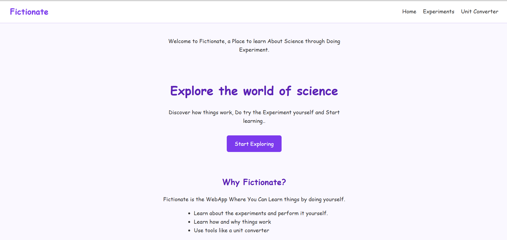
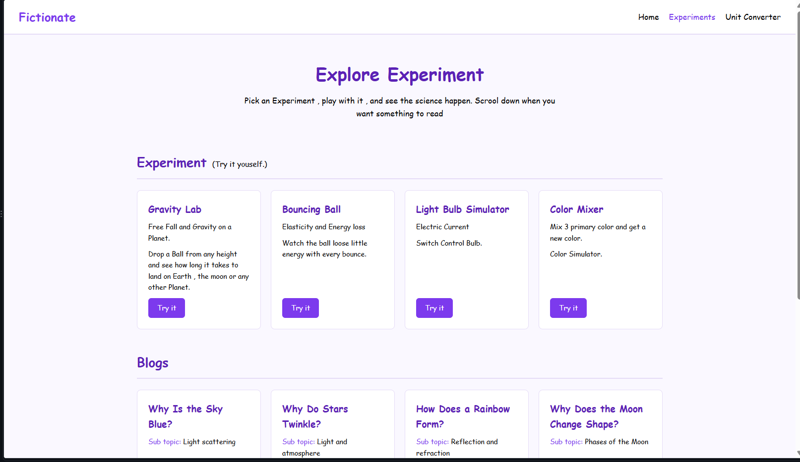
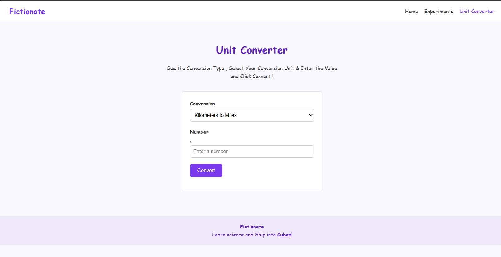

# Fictionate

Fictionate is a science learning website where you can explore science topics, read blogs, and try interactive experiments.

## Screenshots

### Home Page


### Experiments Page


### Unit Converter


## Try it

[GitHub Repository](https://github.com/himanshusapkota/Fictionate)

## Running locally

```bash
git clone https://github.com/himanshusapkota/Fictionate.git
cd Fictionate
```

Open the `Project` folder and launch the HTML page in your browser.

## Built with

- HTML
- CSS
- JavaScript

## Author

[Himanshu Sapkota](https://github.com/himanshusapkota)
